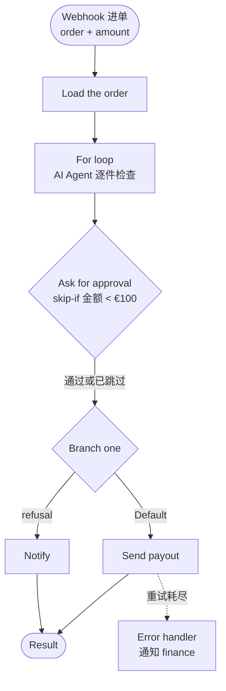

# Mindwill 前期构筑蓝图

把 Mindwill 的 IPaaS 定位、关于文案、五层架构，以及从 Windmill Flow 演示中提炼的构建元素，整理成可迭代的前期构筑蓝图。90% 自动化和性能主张都是目标或定位表述，不是已验证现状。

## 阅读说明

本文是可迭代的前期构筑蓝图，不是已上线产品说明书。Flow 元素与退款流程提炼自 Windmill 官方「What is a flow」演示及文档。形成 90% 自动化是目标，不是现状。「经测试，性能优于 Windmill、Airflow、Prefect、Temporal 和 mindflow.io」是产品定位主张，本文未附测试方法或数据，不作为已验证结论。

## 已拍板决策

2026-11-23（Asia/Shanghai），所有者阳亚运 / Emily Starai 拍板以下三项。这三项按已定事实写入；站点域名仍未取舍。

| 事项 | 决定 |
| --- | --- |
| 第一条可跑通的验证流 | 场景定为跨境电商。具体 Flow 尚未设计，也尚未运行；本文不写具体步骤 |
| 部署 | 私有云部署 |
| 工作流格式 | Mindwill 自研格式：JSON / YAML，加上 TypeScript / Python。这是 Mindwill 自己的格式，不沿用 Windmill 的产品格式；具体 schema 尚未设计。文中的 Windmill Flow 词汇与退款店铺 playbook 只作参照，不是这条验证流，也不是已实现产品 |

站点域名仍开放。About 与拟用标签仍按 mindwill.dev 书写；Mindwill.io、Mindwill.ai、Mindwillai.com 仍是材料中出现过的候选，尚未宣布取舍。

## 定位与目标

> 把你的想法变成专业的可执行代码、AI 工程、app 应用程序；追求稳定性，先跑通验证（SOP、AI 决策、编排 workflow）。
>
> — 天机跨境《Mindwill 设计思路》

| 事项 | 内容 |
| --- | --- |
| 品牌 | 天机跨境旗下的 Mindwill |
| 品类 | IPaaS（集成平台即服务） |
| 站点域名 | About 与拟用标签按 mindwill.dev 书写；Mindwill.io、Mindwill.ai、Mindwillai.com 仍是材料中出现过的候选，尚未宣布取舍 |
| 仓库 | https://github.com/yangyayun2016/mindwill |

### 关于与标签

> 这是一个面向 IPaaS 的平台（集成平台即服务），面向工作流、AI 应用、AI 决策和 AI 代理，用于快速搭建工作流、SOP、AI 工作台、AI 监督学习，是代码优先的生态整合平台，基于速度最快的自托管编排器（经测试，性能优于 Windmill、Airflow、Prefect 和 Temporal、mindflow.io）。业务团队利用 AI 进行构建，业务流、工作流、各种 Flow（信息、资产），工程师则掌控最终发布版本。它是 Lovable、Retool、Dify、FastGPT 和 n8n 的开源替代方案。
>
> — Mindwill 关于

| 事项 | 内容 |
| --- | --- |
| 拟用仓库标签 | ai-agents、airflow-alternative、internal-tools、open-source、orchestration、postgresql、python、rust、self-hostable、self-hosted、typescript、vibe-coding、workflow-engine |
| 构建分工 | 业务团队用 AI 构建业务流、工作流和各类 Flow（信息、资产）；工程师掌控最终发布版本 |
| 自身对照对象 | 开源替代：Lovable、Retool、Dify、FastGPT、n8n；编排性能对照（定位主张）：Windmill、Airflow、Prefect、Temporal、mindflow.io |
| 技术取向（标签，非已实现清单） | Rust、Python、TypeScript、PostgreSQL；自托管 / 可自托管；工作流引擎与 AI agents |

| 目标 | 说明 | 材料中的输出形式 |
| --- | --- | --- |
| 呈现的效果 | 想法变成可执行流程：SOP、AI 决策、编排 workflow；稳定跑通验证；人机协同，越用越好；目标形成 90% 自动化与智能决策，人仍可辅助；业务团队能用 AI 快速搭建，工程师把关发布 | 可视化 Flow、workspace 与工作看板、AI 工作台、审批界面、App 调用 |
| 交付的内容 | 流程定义、可复用连接与资产、组织执行单元、审批与监督记录、复盘结论 | 架构文档、Flow、skill、prompt、知识库与问题库引用、Changelog、复盘报告 |
| 输出格式 | 流程与跑次过程可存储、可回放、可学习。工作流格式已定为 Mindwill 自研：JSON / YAML，加上 TypeScript / Python；具体 schema 尚未设计，本文不预设字段 | 自研 Flow 定义（JSON / YAML，以及 TypeScript / Python）；运行日志与步骤结果；审批记录；资产/密钥引用；Changelog 与各类 log；复盘报告 |

## 五层架构

| 层级 | 职责 | 主要资产 | 给谁看 | 交付物 |
| --- | --- | --- | --- | --- |
| ① 基础建设 / 思考层 | 打通信息孤岛与技术壁垒；汇总连接；私有云部署（已定取向）；目标与流程拆解、编排与 Roadmap；与大模型集成，all-in-one station 的大脑与眼睛；流程编辑器 | MCP、API、ERP、SaaS、App、数据库、知识库（RPA/接口抓取）；云服务器、知识库、问题库、密码库；Skills and MCP connections | 平台与编排者、大模型 | 可复用连接、流程定义、Roadmap |
| ② 执行层 | 部署与构建 Agent/Bot、独立 App/SaaS；企业组织/部门/团队/小组执行任务，也可寻求外部服务 | skill、prompt、组织与管理、知识库、问题库；手和脚、身体各部位 | Agent/Bot 与执行团队 | 可运行的任务与服务 |
| ③ 设计 / 交付 / 应用层 | 区分给人看的与给 AI Agent/Bot 看的；人做交互与决策，大模型辅助编排；稳定输出、监督、执行；工具审批与人工审核 | workspace、工作看板、UI、AI 工作台 | 人（交互与决策）、AI Agent/Bot（被编排的执行视图） | 工作台交互、审批结论、稳定产出 |
| ④ 赋能 / 价值提升层 | 督察、监督、赋能、自主学习；分析、复盘、总结；人机协同，越用越好；目标形成 90% 自动化与智能决策，人仍可辅助 | 运行日志、Changelog、各类 log、黑匣子记录 | 监督者、AI 学习与监督、复盘者 | 复盘报告、决策改进、自动化比例提升（目标） |
| ⑤ 泛化层 | 能力不仅限于跨境电商，扩展到其他行业 | 可复用的流程元素、资产与学习成果 | 其他行业使用者 | 可迁移的能力与编排方法 |

下层为上层提供连接、执行与记录；上层的监督与学习再反馈回编排与决策质量。

## Flow 构建元素

Flow 在参照材料里是步骤图（DAG / 状态机）。Windmill 演示以 JSON 或 YAML 存储，每一步是 worker 上的独立 job。以下元素提炼自 Windmill 演示与文档，并映射到 Mindwill 五层，作为构筑词汇，不是已实现清单，也不是 Mindwill 自研格式的字段 schema。

### 步骤与控制元素

| 元素 | 作用 | 映射层级 |
| --- | --- | --- |
| Action 脚本 | 默认步骤类型，在 worker 上执行一段脚本 | ② 执行层 |
| Approval / Prompt | 挂起流程，等待审批或人工输入 | ③ 设计 / 交付层 |
| 嵌套 Flow | 一步调用另一个 Flow | ② 执行层 |
| For loop | 按迭代器遍历列表，每项可对应一个 job | ② 执行层 |
| While loop | 循环执行，直到取消或某步 Early stop | ② 执行层 |
| Branch one | 按条件只走一条分支 | ② 执行层 / ③ 交付层 |
| Branch all | 各分支并行，如同各自是一条 Flow | ② 执行层 |
| AI Agent | 以智能体执行一步，如逐件检查商品 | ② 执行层 |
| AI Decision | 用 AI 做分支或决策 | ② 执行层 / ④ 赋能层 |
| Trigger | 按条件检查外部事件，再决定是否往下走 | ① 思考层 / ② 执行层 |
| Error handler | 步骤失败且重试耗尽后的统一处理 | ④ 赋能层 |
| Preprocessor | 流程正文开始前的预处理脚本 | ① 思考层 / ② 执行层 |
| Retries | 步骤失败后按 constant 或 exponential 重试 | ② 执行层 / ④ 赋能层 |
| Early return / skip-if | 可提前返回；或按条件跳过某步（演示为 `flow_input.amount < 100` 跳过审批） | ② 执行层 / ③ 交付层 |
| Shared directory | 步骤间通过 `./shared` 传递不适合放入 JSON 的数据 | ① 基础建设层 |

### 数据、触发与资源

| 事项 | 内容 |
| --- | --- |
| 步骤结果 | `results.<step_id>.<field>`，如 `results.load_order.items` |
| 流程输入 | `flow_input`，如 `flow_input.amount` |
| 流程环境 | `flow_env.VARIABLE_NAME`（流程级常量，可为字符串、JSON 或资源） |
| 静态输入 | 写在步骤里的固定值 |
| 默认输出 | 最后一步的结果；若提前出错或设置了 Early return，则按该规则返回 |
| 触发 | Webhooks、Schedules、HTTP routes、Emails、Kafka topics、Postgres changes；以及 UI、CLI、App、另一个 Flow |
| Resources | 连外部系统；演示中为 Stripe，路径例如 `f/shop/stripe` |
| Apps | 把 Flow 当后端调用；演示中 type 为 flow，路径为 `f/shop/refund` |

### 编辑方式与容错人工

| 能力 | 材料中的做法 | 映射层级 |
| --- | --- | --- |
| 可视化编辑 | Flow editor 拖拽步骤，组装分支、循环、审批与错误处理 | ① 思考层 / ③ 交付层 |
| AI Session | 用自然语言生成 Flow；演示提示为 Build a flow that refunds an order, with an approval over 100 euros | ① 思考层 / ③ 交付层 |
| CLI | 在本地终端编写、触发或同步 Flow | ① 思考层 / ② 执行层 |
| MCP 代理 | 编程代理通过 MCP 编写与编排 | ① 思考层 / ② 执行层 |
| Workflows as code | 用 TypeScript 或 Python 编写；每个 `task()` 是一个 job，触发源与脚本相同 | ① 思考层 / ② 执行层 |
| 失败重试 | constant 或 exponential；演示为 3 次，间隔 5、25、125 秒 | ② 执行层 / ④ 赋能层 |
| Error handler | 重试耗尽后统一处理；演示中通知 finance，流程以失败结束 | ④ 赋能层 |
| 挂起审批 | 秘密链接、多人审批、超时、拒绝分支、Continue on disapproval；挂起期间不占用 worker；演示中大额需 2 人审批，最多等待 3 天 | ③ 交付层 |
| 从某一步重启 | 复用之前步骤结果，只跑剩下的步骤；演示注明该能力在 Windmill 的 Cloud & Enterprise 方案中提供 | ④ 赋能层 |

## 退款审批原理图与验证 Playbook

这是 Windmill 官方演示中的虚构店铺退款流程，用来对照触发、资产、AI 决策、人工审批、容错与黑匣子。它只是参照示例，不是已选定的第一条验证流，也不是已经上线的业务。

1. **触发**  
   用 Webhook 传入订单号与金额。演示中小额为 `ORD-1042` / €60，大额为 `ORD-2077` / €2,000。
2. **资产调用**  
   Load the order；支付走 Resource（演示为 `f/shop/stripe`）。如有 App，可把该 Flow 当后端（演示路径 `f/shop/refund`）。
3. **AI 决策**  
   For loop 中 AI Agent 逐件检查退货商品，每件一个 job。演示中 3 件商品（mug、poster、lamp）对应 3 个 job。
4. **人工审批**  
   金额 < €100 则 skip-if 跳过审批，走 Default 打款。大额需多人审批（演示为 2 人各获秘密链接）；挂起期间不占用 worker，可设超时（演示最多 3 天）。拒绝或超时默认失败，也可 Continue on disapproval，由 refusal 分支 Notify。
5. **容错**  
   支付失败则按 constant / exponential 重试（演示 3 次，间隔 5、25、125 秒）；仍失败则 Error handler 通知 finance，流程以失败结束。也可从某一步重启（演示注明 Cloud & Enterprise）。
6. **黑匣子记录**  
   保留输入、步骤结果、跳过/审批决策、重试与错误、Changelog，供复盘与学习。

## 资产管理、AI 学习、AI 监督、黑匣子

| 事项 | 是什么 | 用来做什么 |
| --- | --- | --- |
| 资产 | 密钥、资源、连接、知识库、问题库、流程定义与 skill | 稳定、低调用成本、安全、可复用地调用外部系统与内部能力 |
| 黑匣子 | 跑次全过程记录：输入、步骤结果、审批决策、重试、错误、Changelog | 分析、复盘、总结，提升系统能力 |
| AI 监督 | 用 AI 看异常与违规，做督察与监督 | 稳定输出，发现问题 |
| AI 学习 | AI 学习人的审批与决策，反馈回编排与决策质量 | 人机协同，逐步提升自动化比例（目标 90%，人仍可辅助） |

黑匣子只落定记录类别，不预设字段 schema。审批决策至少要能回放：批准或拒绝、审批人、超时、是否 Continue on disapproval。

## 竞品与对照范围

下面 31 条是 2026-11-20（Asia/Shanghai）从 [Windmill alternatives and comparisons](https://www.windmill.dev/compare) 核对到的官方对照目录（页面声明 numberOfItems 为 31），作为 Mindwill 后续对照清单，不是 Mindwill 已经写好的对比文。Dify、FastGPT、mindflow.io 出现在 Mindwill 关于文案中，但不在该 31 条里。对照阅读要点、Temporal 参照，以及 Windmill 信任中心的安全与合规摘记，见 [research-notes.md](research-notes.md)。

| 分类 | 条目 | 来源页 |
| --- | --- | --- |
| 工作流编排与数据引擎 | 8 open-source Airflow alternatives, compared by use case | https://www.windmill.dev/blog/airflow-alternatives |
| 工作流编排与数据引擎 | Windmill vs Airflow | https://www.windmill.dev/compare/airflow |
| 工作流编排与数据引擎 | Windmill vs Camunda | https://www.windmill.dev/compare/camunda |
| 工作流编排与数据引擎 | Windmill vs Dagster | https://www.windmill.dev/compare/dagster |
| 工作流编排与数据引擎 | Windmill vs dbt | https://www.windmill.dev/compare/dbt |
| 工作流编排与数据引擎 | Windmill vs Kestra | https://www.windmill.dev/compare/kestra |
| 工作流编排与数据引擎 | Windmill vs Prefect | https://www.windmill.dev/compare/prefect |
| 工作流编排与数据引擎 | Windmill vs SSIS | https://www.windmill.dev/compare/ssis |
| 工作流编排与数据引擎 | Windmill vs Temporal | https://www.windmill.dev/compare/temporal |
| 工作流自动化与 iPaaS | Windmill vs Make | https://www.windmill.dev/compare/make |
| 工作流自动化与 iPaaS | Windmill vs n8n | https://www.windmill.dev/compare/n8n |
| 工作流自动化与 iPaaS | Windmill vs Pipedream | https://www.windmill.dev/compare/pipedream |
| 工作流自动化与 iPaaS | Pipedream alternatives after the Workflows shutdown | https://www.windmill.dev/docs/compared_to/pipedream_alternatives |
| 工作流自动化与 iPaaS | Windmill vs Power Automate | https://www.windmill.dev/compare/power-automate |
| 工作流自动化与 iPaaS | Windmill vs Workato | https://www.windmill.dev/compare/workato |
| 工作流自动化与 iPaaS | Windmill vs Zapier | https://www.windmill.dev/compare/zapier |
| 内部工具与应用构建 | Windmill vs Lovable | https://www.windmill.dev/compare/lovable |
| 内部工具与应用构建 | Windmill vs Replit | https://www.windmill.dev/compare/replit |
| 内部工具与应用构建 | Windmill vs Retool | https://www.windmill.dev/compare/retool |
| 内部工具与应用构建 | Windmill vs Superblocks | https://www.windmill.dev/compare/superblocks |
| 安全自动化 | Windmill vs Tines | https://www.windmill.dev/compare/tines |
| 基础设施与 IT 自动化 | Windmill vs Ansible Automation Platform | https://www.windmill.dev/compare/ansible-automation-platform |
| 基础设施与 IT 自动化 | Windmill vs Azure Automation | https://www.windmill.dev/compare/azure-automation |
| 基础设施与 IT 自动化 | Windmill vs Itential | https://www.windmill.dev/compare/itential |
| 基础设施与 IT 自动化 | Windmill vs PowerShell Universal | https://www.windmill.dev/compare/powershell-universal |
| 基础设施与 IT 自动化 | Windmill vs Rundeck | https://www.windmill.dev/compare/rundeck |
| 基础设施与 IT 自动化 | Windmill vs VisualCron | https://www.windmill.dev/compare/visualcron |
| 基础设施与 IT 自动化 | Windmill vs VMware vRA | https://www.windmill.dev/use-cases/vmware-vra-replacement |
| 基础设施与 IT 自动化 | VMware Aria Automation alternatives, by what each one replaces | https://www.windmill.dev/blog/vmware-aria-automation-alternatives |
| 基础设施与 IT 自动化 | Windmill vs Windows Task Scheduler and SQL Server Agent | https://www.windmill.dev/compare/windows-task-scheduler |
| 更多对照 | Windmill alternatives: when to pick something else | https://www.windmill.dev/docs/compared_to/peers |

## 前期构筑顺序

以下为建议顺序，不是已决定的完整 Roadmap。架构文档、Flow 元素词汇、参照示例 playbook 与黑匣子字段类别已经写入仓库。最小可跑通的验证流已选定场景为跨境电商；具体 Flow 尚未设计，也尚未跑通。

| 事项 | 状态 | 说明 |
| --- | --- | --- |
| 公开仓库已创建 | 已完成 | yangyayun2016/mindwill，2026-11-19 创建 |
| 定位已落在设计思路文档里 | 已完成 | 天机跨境旗下 Mindwill，IPaaS |
| 关于文案、拟用标签与对照范围已写入蓝图 | 已完成 | mindwill.dev；本文档即仓库中的蓝图正文 |
| 把五层架构文档写入仓库 | 已完成 | 见本文「五层架构」 |
| 沉淀 Flow 元素词汇 | 已完成 | 见本文「Flow 构建元素」 |
| 写入退款审批示例 playbook | 已完成 | Windmill 演示的参照示例，不是已选定的第一条验证流，也不是线上业务 |
| 设计黑匣子字段类别 | 已完成类别，不锁 schema | 输入、步骤结果、审批决策、重试、错误、Changelog |
| 写入对照与参照笔记 | 本提交写入 | 见 [research-notes.md](research-notes.md)；整理笔记，非实测、非 Mindwill 已有认证 |
| 选定一个最小可跑通的验证流并先跑通 | 场景已定，设计与跑通未开始 | 场景为跨境电商。具体 Flow 尚未设计，也尚未运行 |

## 来源

- [Mindwill 仓库](https://github.com/yangyayun2016/mindwill)
- [Flows quickstart](https://www.windmill.dev/docs/getting_started/flows_quickstart)
- [Workflows as code](https://www.windmill.dev/docs/core_concepts/workflows_as_code)
- [Windmill alternatives and comparisons](https://www.windmill.dev/compare)
- [Temporal](https://temporal.io/)
- [Windmill Trust Center](https://trust.windmill.dev/)
