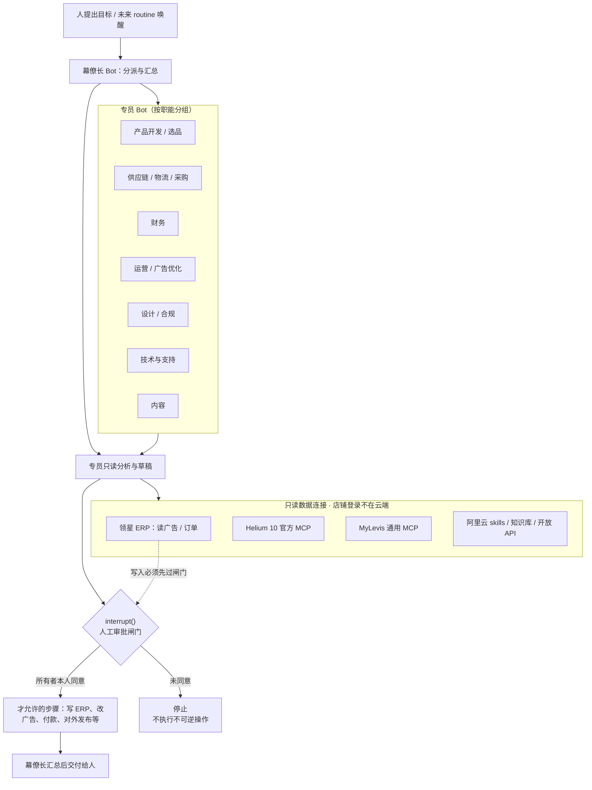

# 01 亚马逊运营框架 SOP 架构总览

> 结构与口径对齐已合并的 [PR #4](https://github.com/yangyayun2016/mindwill/pull/4)（`docs/sop/_template.md`、`docs/bots/_template.md`，提交 `ecf01ce`）。  
> 状态：**草稿（已补齐飞书思维笔记原文，X.com 长文未发布）。**  
> 日期：2026-11-24（Asia/Shanghai）  
> 品牌占位：**Mindwill × 天机跨境**（待拍板。材料中还出现 Bailing跨境、领鹿、BailingADS。）

## 阅读说明与事实边界

本篇是 Mindwill 跨境电商验证流的第 1 篇架构总览，不是已上线产品说明书，也不是某一条已跑通 Flow 的运行报告。本仓库目前没有可运行产品代码；没有可核验的实现记录时，不写「已核实实现」。

事实等级只用三档：`已核实实现`、`附件 / 实践陈述`、`待从飞书 SOP 补齐`。2026-11-24 已从飞书思维笔记（[K7Dww766YitgNKkCsMzcqNZ4nhb](https://tianjikuajing.feishu.cn/wiki/K7Dww766YitgNKkCsMzcqNZ4nhb)）提取全部可展开的灰色备注原文。凡已写入本篇的飞书规则，等级为 **附件 / 实践陈述**，不是已核实实现。

同名兄弟飞书文档（[L90lw6QPcitGTykSTL7cldfAnje](https://tianjikuajing.feishu.cn/wiki/L90lw6QPcitGTykSTL7cldfAnje)）经比对与先前文章 Word 附件正文一致，没有多出新的 SOP 章节。

明确不做的事：

- 不把先前文章里的「10/17 自动上架、10/18 FBM 全链路」等写成 Mindwill 已验证结果
- 不把导图或课件里的示例数字（如转化率 8%、CPC 0.5 元、平均 ACOS 27%）写成某店铺实绩
- 不编造飞书未给出的阈值、字段名或 cron
- 思维笔记中 12 处嵌入课件显示 `Loading...`，本篇如实说明，不从水印图补全被挡住的表格

---

## 基本信息

| 项 | 内容 |
| --- | --- |
| 构筑编号 | `01` |
| 名称 | 亚马逊运营框架 SOP 架构总览 |
| 对应 Bot | 幕僚长 Bot（总协调）；专员按职能分组。各卡职责全文待后续 `docs/bots/<bot>.md` 分篇填写 |
| Mind / 定位 | 站在所有者与幕僚长一侧，先锁组织骨架、数据边界、广告分析路径与审批闸门。不在本篇展开尚未设计的单条验证 Flow，也不判断具体竞价数字 |
| 状态 | 草稿 |
| GitHub 路径 | `docs/sop/01-amazon-ops-framework-overview.md` |
| X.com | 未发布。得到所有者本人同意并发布后，改为帖子 URL |
| 自研配置路径 | `flows/`（待建。JSON / YAML 字段 schema 未定，此处不写键名） |
| 状态图路径 | `graphs/`（待建。LangGraph Python 或 TypeScript，尚未放入代码） |

## 一句话钩子与核心结论

钩子：先把「人只拍板、幕僚长协调、专员按职能干活、写操作停在闸门前」这套骨架画清楚，再谈自动改广告。

核心结论：组织编制、数据连接边界、每日选品的淘汰逻辑、广告止损 / 增益六层规则，以及「可逆的、读数据的事让 Bot 干；不可逆的、花钱的事人来按按钮」，已经可以从飞书原文写进总览。各岗位定制职责、字段级字典、12 张课件全文，以及第一条可跑通的 LangGraph 验证 Flow，仍不能在本篇当成已经完成。

## The skill / app / system at a glance

一目了然。只用下面四行说清这篇构筑。

| 一眼能看见的东西 | 内容 |
| --- | --- |
| 它是什么 | system：Mindwill × 天机跨境的亚马逊运营团队骨架（基础版）。一个人拍板，一个幕僚长 Bot 总协调，十个职能专员组执行 |
| 谁启动，谁收结果 | 人向幕僚长提出目标，或未来的 routine 唤醒某专员（时刻表未定，默认关闭）。结果由幕僚长汇总后交给人 |
| 人在哪里说「可以」 | 原理图中的 `interrupt()` 闸门：压货、加钱、改品、喊停、付款、以及所有写操作；外加统一红线中的对外发送、公开发布、承诺价格或交付时间、删除数据 |
| 现在还不能自动做什么 | 不能自动改广告、自动付款、自动上架、自动对外发布。自动 routine 在上线判据满足前保持关闭 |

专员编制以本脑图为准（与更早 Word 文首清单不完全相同，差异待所有者拍板）：产品开发/选品（选品情报、产品经理、采购专员）；供应链管理；物流专员；采购专员（是否与选品组内采购重复，待确认）；财务（源文件标题为「财务主管、」，顿号后是否还有职务名待补）；运营/广告优化（亚马逊运营、亚马逊广告助手、ASIN 风控专员、自动化运营）；设计；合规师；技术与支持（云服务器架构、知识库、日常助理／Mac 管家、英语专家）；内容（视觉内容、公众号、PPT 专家、bailingads 网站建设）。

数据边界一眼能看见的：领星 ERP、Helium 10 官方 MCP、MyLevis 通用 MCP、阿里云（skills / 知识库 / 领星开放 API）可读；写操作需人工确认；店铺登录只在本地紫鸟，绝不上云。

## 原理图

图上的闸门对应执行层的 `interrupt()`。闸门画出来，不等于它已经在运行环境里拦住了写操作。店铺登录不画进云端。

## 工作流与功能

触发方式：人向幕僚长提出目标；或材料所述「各类日常任务按 routine 定时跑」，但具体 cron **待补**，固定任务在上线判据满足前不开启。协作方式（单聊专岗、跨部门拉群）来自先前文章附件，等级为附件 / 实践陈述。

### 总览层步骤

| 序号 | 步骤 | 执行者 | 停等审批点 | 事实等级 | 这一步算做完的判据 |
| --- | --- | --- | --- | --- | --- |
| 1 | 提出目标或到点唤醒 | 人，或未开启的 routine | 无 | 附件 / 实践陈述 | 幕僚长收到可执行的目标 |
| 2 | 分派专员，只读取数与分析 | 幕僚长 Bot；对应专员 Bot | 无 | 附件 / 实践陈述 | 产出建议或草稿，不写回外部系统 |
| 3 | 若下一步会改线上、付款、对外发送或任何写操作，暂停 | 执行层 `interrupt()` | `interrupt()`：等所有者本人同意 | 附件 / 实践陈述 | 拟执行内容已交给人，图停在闸门 |
| 4 | 同意后继续；未同意或超时则停止 | 人；图以 `Command(resume=...)` 恢复 | 未同意则不执行 | 附件 / 实践陈述（编排映射尚未落代码） | 不可逆动作要么明确同意后执行，要么未发生 |
| 5 | 汇总交付，需要时写入日志 | 幕僚长；选品分支有「日志」槽 | 对外发布日志内容须再过闸门 | 附件 / 实践陈述 | 人收到一份干净结果；缺口已标明 |

### 产品开发 / 选品（飞书原文已补齐）

每日选品原文（附件 / 实践陈述）：

> 每天推 5-7 个品，带利润测算，再做四个维度的体检：流量、竞争度、ABA 头部三家是否垄断等。过不了的直接淘汰，不浪费时间。

输出进入选品「日志」槽，字段格式待补。淘汰是分析结论，不自动等于上架或采购；上架、下单、付款必须另过闸门。

### 运营 / 广告优化 — 岗位全景（13 条，飞书原文）

飞书岗位总览（附件 / 实践陈述）。标注了协作部门的三条，本总览只记录边界，不把客服部、销售支持部写成已经单独建好的 Bot：

1. 管理及维护店铺安全，规避 Amazon 帐号各类安全问题
2. 及时掌握跨 Amazon 平台各项政策与制度，并提交相应的可行性方案
3. 完成产品上架及优化要求
4. 为产品制定和执行销售策略，完成销售目标
5. 分析市场及竞争对手，调整产品销售策略
6. 综合分析产品各项数据，提高产品销量和排名
7. 及时安排各类销售活动，跟进活动效果
8. 及时跟进产品的中差评
9. 解决客户的售后问题，解决客户的退换货要求 —客服部—
10. 制定站内广告计划并实施
11. 分析广告数据，根据数据及时进行优化 —广告研发部—
12. 定期统计、分析销售及库存数据，保持健康的库存周转率和库存量 —销售支持部—
13. 依据数据分析、平台政策与客户反馈等，向产品开发提出产品改进方案与新品开发思路

其中「完成产品上架及优化要求」「制定和执行销售策略」「安排销售活动」「制定站内广告计划并实施」若落到写回平台或对外承诺，必须先过闸门。

### 广告研发部、分工与 6 步闭环（飞书原文）

广告研发部职能（6 条）：负责指定帐号站点或分配相应产品的广告效果数据分析，并针对销售端运营效果进行跟踪及原因分析；通过自研系统 / 现有智能广告工具对广告数据指标实时监控分析，能发现广告操作技术性异常问题；处理广告异常问题，并对处理结果周期性复核和效果持续跟进；总结归纳历史广告问题，结合运营反馈记录成相应文档，并形成广告操作理论方法；每周总结分析并汇报所负责的广告数据、广告绩效、产品利润等核心数据；每周总结分析并向总经办汇报运营人员的绩效总结。向总经办汇报本身若经对外渠道发送，须先过闸门。

工程师 / 工具（3 条）：批量获取公司所有亚马逊账号的广告数据，整理出问题广告数据给分析师；负责数据分析系统与汇报系统的优化与完善；根据分析师与运营师的要求不断增强数据系统的功能。

广告优化师（4 条）：分析广告数据，提出优化建议，预估优化效果；与运营沟通，确定优化操作；定期复盘优化效果，对比分析实际效果与预估效果的差异之处与归因；记录并总结归纳广告的优化细节与效果。

内部运作 6 步闭环（飞书原文，标注咕噜公园 GULU PARK）：

| 序号 | 步骤 | 执行者 | 停等审批点 | 事实等级 | 这一步算做完的判据 |
| --- | --- | --- | --- | --- | --- |
| ① | 数据清洗：批量获取数据，并筛选出问题数据 | 工程师 / 工具 | 无（只读） | 附件 / 实践陈述 | 问题数据已交给分析师 |
| ② | 运营师提供数据：关键词词库、否定词词库、竞品调研 | 运营师 | 无（提供资料） | 附件 / 实践陈述 | 词库与调研已交到优化师 |
| ③ | 数据分析：提供优化建议，预估优化效果 | 广告优化师 | 无（建议尚未写入） | 附件 / 实践陈述 | 建议与预估已形成 |
| ④ | 确定优化操作：优化师与运营师沟通 | 优化师、运营师 | 若拟写回广告平台，在确认后进入闸门 | 附件 / 实践陈述 | 双方确认拟执行操作清单 |
| ⑤ | 调整广告：运营师进行相应的调整 | 运营师 | `interrupt()`：改竞价、预算、否词、暂停、新建计划等写回必须先经所有者本人同意 | 附件 / 实践陈述 | 仅在同意后调整；未同意则不改 |
| ⑥ | 效果复盘：一周后，优化师复盘广告优化效果 | 广告优化师 | 无（复盘为只读）；若据此再改广告，回到步骤 ④⑤ | 附件 / 实践陈述 | 预估与实际的差异及归因已交出 |

### 幕僚长、核心思路与人守 6 道闸（飞书原文）

幕僚长 Bot：总协调。各个专员的产出它来汇总，遇到要花钱、要改方向的事，它往上升级给我。

核心思路是把「人」放在最上面，只做决策。人（我）：只拍板，不搬砖。

人守的几道闸原文：

> 全自动不等于放手不管。下面这些必须我批：压货、加钱、改品、喊停、付款、以及所有写操作。逻辑很简单：可逆的、读数据的事让 Bot 干；不可逆的、花钱的事人来按按钮。

待从飞书 SOP 补齐：各岗位定制职责（见下节，11 卡目前仍是统一模板）；12 处 `Loading...` 课件正文；MCP / API 字段级字典与 routine 时刻表。

## 数据来源

字段名等 JSON / YAML schema 拍板后再与配置对齐。下表只记录已点名的来源，不发明未出现的字段。店铺登录不作为云端数据源。登录只在本地紫鸟。

| 字段名 | 含义 | 来自哪个 MCP / API / 第三方 | 读 / 写 | 查不到时的处理 |
| --- | --- | --- | --- | --- |
| 字段名未定（广告、订单） | 读广告、读订单 | 领星 ERP（多店授权；开放 API 在阿里云上跑，endpoint 待补） | 只读可；写入必须先过闸门 | 标为未知，禁止编造；升级给幕僚长或所有者 |
| ABA、SQP、Cerebro 反查、关键词搜索量 | 选品与关键词研究常用数 | Helium 10 官方 MCP（OAuth 接到 `mcp.helium10.com`，账号密码不经过 Bot；另有未点名「中转」） | 材料按只读描述；写入待补 | 同上 |
| 字段名未定（目录工具各自的数） | 多工具入口；材料转述目录含卖家精灵、Helium 10、Sorftime、Keepa、SIF、Kalodata、极目数据（Jiimore）等。「389+ / 22 家」为官网转述，未核验 | MyLevis 通用 MCP | 待按工具补；写入必须先过闸门 | 同上 |
| skills、知识库 | 技能与知识存放 | 阿里云（SSH 只允许密钥登录、每天自动备份，为附件陈述） | 运维变更视为写入，须确认 | 同上 |
| 店铺登录会话 | 登录亚马逊后台 | 本地紫鸟，绝不上云 | 不上云；经此后台的写操作仍要闸门 | 不得把登录转到云端来「补救」 |
| Listing 图片 / 视频 | 视觉素材 | 本地 Mac / Codex（脑图还列了视频制作） | 发布到 Listing 前须经闸门 | 同上 |
| 流量、竞争度、ABA 头部三家是否垄断、利润测算 | 每日选品四维体检与测算（飞书已点名维度，字段名未定） | 待补：应与 Helium 10 ABA 等已点名源对齐，不得臆造其它源 | 只读分析；上架或采购须另过闸门 | 缺维则不做「通过」，按原文淘汰或升级 |
| 花费、出单、转化率、超预算时间、预算占比、ACOS、点击率、搜索量、排名、点击量、订单量、销量及销量占比 | 止损 / 增益六层分析用指标（飞书已点名，系统字段名待补） | 待补：领星广告数据是材料中已点名的候选，不把课件里未确认的工具名写成已授权集成 | 只读分析可；调预算、降价/提价百分比、否词、暂停、移词打手动、加入或新创广告计划均须先过闸门 | 标为未知，禁止编造；升级给优化师汇报对象或幕僚长 |
| 关键词词库、否定词词库、竞品调研 | 6 步闭环中运营师提供的输入 | 运营师提供；来源系统待补 | 只读输入 | 缺资料则步骤 ③ 标明未知，不编词库 |

## 编码编排

Mindwill 自研 JSON / YAML 是配置层，LangGraph 是它下面的状态图执行层。左列是职责，不是字段名。schema 未定之前，不在本表填写键名。

| 配置层要表达的职责 | 映射到的执行层原语 | 本构筑（字段名留空） |
| --- | --- | --- |
| 整篇构筑的状态与转移 | `StateGraph` | 父图记住目标、当前专员、只读分析结果、拟写回操作、闸门是否已同意。不写 JSON 键 |
| 可复用子流程 | `Subgraphs` | 每个专员组或已展开 SOP（每日选品、广告研发 6 步闭环）作为子图 |
| 暂停之后还要保留的跑次状态 | Checkpointer，如 `PostgresSaver` | 私有云默认 Postgres。连接串不写进本文 |
| 必须停下来等所有者本人同意的点 | `interrupt()` | 与原理图及人守 6 道闸、统一红线一一对应：压货、加钱、改品、喊停、付款、所有写操作，以及对外发送、公开发布、承诺价格或交付时间、删除数据 |

语言取向：Python 与 TypeScript 均在已拍板范围内，本篇图尚未选择实现语言。`@langchain/langgraph` 是 TypeScript 包名；选定语言不是已经写好的图。LangSmith Agent Server 自托管 / standalone 当前不绑定。

## 分析路径与逻辑

按判断顺序写，不把相关性写成原因。每一步都指回数据来源或工作流。等级：附件 / 实践陈述（飞书原文）。

### 总览层

1. 先看这是只读分析，还是已经触及写回、付款或对外承诺。后者先停在闸门，不先执行再请示。
2. 查不到的字段标为未知，列出已查来源与缺口，升级给幕僚长或人；禁止用相邻数据或模型估计补空。
3. 因此不能下的结论：本篇不宣称任何店铺已经自动跑通，也不用课件示例数字推断某店盈亏。

### 每日选品

1. 先看候选品的利润测算。
2. 再做四个维度的体检：流量、竞争度、ABA 头部三家是否垄断等。
3. 过不了的直接淘汰，不浪费时间。缺维或来源无返回时，不得改判为「通过」。

### 广告：先定目的，再按六层分析

分析数据前先明确目的，不能用同一套动作同时当止损和冲量，除非后续单篇 SOP 明文允许。飞书给出三类目的：

1. 减少广告费浪费（不好→降低影响；不好→好）——止损
2. 增大现有效益（好→更好）——增益
3. 其他目的：打曝光、打收录（仅有方向，无本层规则表）

**止损 6 层**（减少广告费浪费）：

| 层级 | 飞书原文规则 | 若落到写入，须经 `interrupt()` 的含义 |
| --- | --- | --- |
| 广告活动 | 获得「最近 3 天有花费不出单」的广告活动数据；分析转化率、超预算时间来调整预算 | 调整预算 |
| 广告组 | 一般本层级只用于分析广告架构是否设置合理；分析各广告组之间的预算占比及效益决定广告架构是否需要调整 | 调整广告架构或组间预算 |
| 广告位 / 竞价策略 | 分析转化率、ACOS 决定是否降价百分比和调整竞价策略 | 降价百分比、改竞价策略 |
| 投放 | 分析转化率、点击率、ACOS、搜索量、排名决定是否降价 | 降价 |
| 搜索词 | 分析点击量、订单量决定是否否定 | 否词 |
| 广告 ASIN | 分析点击量、订单量决定是否暂停 | 暂停投放 |

**增益 6 层**（增大现有收益）：

| 层级 | 飞书原文规则 | 若落到写入，须经 `interrupt()` 的含义 |
| --- | --- | --- |
| 广告活动 | 分析转化率、超预算时间来调整预算 | 调整预算 |
| 广告组 | 分析转化率、超预算时间来调整预算；并分析架构是否合理、各广告组预算占比及效益，决定是否调整架构 | 调预算或架构 |
| 广告位 / 竞价策略 | 分析转化率、ACOS 决定是否提价百分比和调整竞价策略 | 提价百分比、改竞价策略 |
| 投放 | 分析转化率、点击率、ACOS、搜索量、排名决定是否提价 | 提价 |
| 搜索词 | 分析点击量、订单量决定是否移词打手动 | 移词到手动广告 |
| 已购买 ASIN | 分析销量及销量占比决定是否添加到现有或新创广告计划中 | 加入现有计划或新创计划 |

复盘（对应 6 步闭环之 ⑥，一周后）：对比预估与实际并做归因。导图中曾看清的差异核对项（期间是否还有其他优化、Listing 状态、投放词排名与竞争环境）可作参考，完整课件表仍因 `Loading...` 与水印待补，不把示例数字当实绩。

### 广告优化师工作细节与打法全景

飞书「工作细节分享」是一条运营方法论清单，不是已参数化的自动规则。本篇只索引，**具体自动化节点与参数阈值在后续单篇 SOP 中拆解**，此处不编阈值。

原文已出现的维度包括：阶段、品类、打法、广告目的；新品期自动广告的提高和降低；看竞价策略分布（商品页面还是首页首位）；手动广告词组匹配，或由词频统计得出词根后做广泛匹配；SPR 大概上首页的单量出单词，做衍生拓词；特征词分析（人群 / 场景 / 属性等）；单点极致集中爆破与流量格局；自然流量份额；关键词坑位快照；广告盈亏（评分）平衡测算与关键词对标；关键词一页纸总表（关键词、出单、搜索词、投放词）；BI 打法（捡漏广告、海王广告、错峰分时调价、前置否词、词根排列组合 ABCD、漏斗否词）；广告类型布局（SPV、SBV、SD、DSP、SB 多变体）；核心爆款做数据引流、流量外溢、做利润。

其中错峰分时调价、前置否词、漏斗否词、多类型布局等，一旦写回广告平台，仍须先过闸门。

## 实现目的与输出结果

| 项 | 内容 |
| --- | --- |
| 目的 | 把公司职能落成可检查的 Bot 岗位与审批边界，让后续子 SOP 和第一条验证 Flow 有地方挂 |
| 输出格式 / UI / 看板 | 本篇为 GitHub Markdown + 原理图，以及同步用的 X 长文稿。选品日志、广告建议看板尚未设计 |
| 交付给谁 | 所有者审阅；日常运行后由幕僚长汇总给人。每周广告数据 / 绩效 / 产品利润及运营人员绩效，飞书写明向总经办汇报 |
| 什么时候交付 | 本总览在所有者审阅并授权入库之后。日常选品按「每天」陈述；广告复盘为「一周后」；每周汇报。时刻表未写成 cron |
| 是否固定任务，频次是什么 | 材料有每日选品与每周汇报。固定任务在上线判据满足前不开启 |
| 结论如何影响决策 | 人可以据此决定淘汰哪个品、哪条广告建议进入闸门、哪类动作永远必须亲自批。不能直接改成「已经自动执行」 |

## 四栏能力卡

只写已有材料能支撑的条目。没有就写「尚无」，不用行业常识填。

| 栏 | 所指 | 本构筑 |
| --- | --- | --- |
| Memories | Facts it already knows | 人只拍板；幕僚长是默认协调入口。紫鸟登录不上云。可逆的、读数据的事让 Bot 干；不可逆的、花钱的事人来按按钮。广告先分止损 / 增益 / 其它（打曝光、打收录）。每日选品过不了四维体检就淘汰。查不到则标明未知，不编造。对外品牌与最终编制尚未拍板 |
| Skills | Playbooks it can run | 本篇架构总览。已有目录、待写成独立 skill / 子 SOP 的：每日选品；广告研发 6 步闭环；止损 / 增益六层分析（建议阶段）。不能宣称可跑：自动改广告、自动付款、自动上架、自动对外发布 |
| Routines | Jobs that run on their own | 默认关闭。人工跑通一轮，并且确认闸门能拦住写操作之前，不填写可执行 cron，也不开启。材料仅陈述「有 routine、每天选品、一周后复盘、每周汇报、阿里云每天备份」 |
| Integrations | Apps it can use | 领星 ERP（含开放 API）、Helium 10 官方 MCP、MyLevis 通用 MCP、阿里云（skills、知识库、API 托管）、本地紫鸟（登录隔离，不列为云端集成）、本地 Mac / Codex、底层编排 LangGraph。课件中未确认的工具名不列入已授权集成 |

## 关联 Bot 职责摘要

主责 Bot：幕僚长 Bot。职责全文待 `docs/bots/chief-of-staff.md`（尚未创建）。

- 负责：总协调；把各专员产出汇总成一份干净结果；遇到要花钱或改方向的事，升级给所有者
- 可以查：已授权的只读集成，以及专员交来的分析；不绕过紫鸟登录店铺
- 可以交给它的工具：分派专员、汇总、升级；工具若能对外发送、发布、付款、改 ERP 或删除数据，默认不能直接用，先走红线
- 最后要交的结果：给人一份汇总，标明结论与未知项
- 查不到时：禁止编造；标为未知，写明查过哪一个来源、缺的是什么，升级给所有者。没有约定降级办法时，停下来问，不继续往下做不可逆动作

### 11 张职责说明卡的真实状态（经飞书核实）

飞书里下列 11 处「职责说明」**均存放同一段统一模板原文**，尚未逐岗位填入定制明细：选品与产品、供应链管理、物流专员、采购专员、财务、ASIN 风控监控、广告调整建议、设计、合规师、公众号写作、幕僚长 Bot。「以及所有写操作」下只有标签，无正文。

统一模板原文：

> 我的bot职责说明，里面会写清楚它负责什么，可以查哪些来源，可以用哪些工具，最后要交什么样的结果，哪些动作必须先得到他的同意，以及查不到信息时该怎么办。最后还有一条红线。凡是对外发送消息或文件、公开发布内容、动用资金、承诺价格或交付时间、删除数据，以及其他任何不可逆操作，都必须先停下来征得我本人的同意。

因此本总览保留该统一模板，并在正式红线节使用仓库已拍板的两段原文。逐岗位细节留待后续分篇 `docs/bots/<bot>.md` 补齐。在此之前，专员默认只做本职范围内的只读分析与草稿。

广告线已有、可先写入摘要的非模板正文：运营 13 条全景、广告研发部 6 项、工程师 / 工具 3 项、广告优化师 4 项（见上文）。技术与支持、内容组的分组名称已见飞书，仍无分岗定制卡。

## 统一不可逆操作红线

下面两段原文保留，不可删减，不可改写成更宽的例外。

凡是对外发送消息或文件、公开发布内容、动用资金、承诺价格或交付时间、删除数据，以及其他任何不可逆操作，都必须先停下来征得所有者本人同意。

跨境运营补充闸门：店铺登录只在本地紫鸟、绝不上云；ERP 等外部系统的写操作与付款一律人工确认。

飞书另列、须与上述两段同时遵守的人守闸门：压货、加钱、改品、喊停（以及其中已覆盖的付款、所有写操作）。

## 上线判据

You're ready to move on when：

1. 人工跑通一轮。这一轮的输入是（一条明确的选品或广告分析目标，以及已授权的只读数据）。预期输出是（带利润测算与四维体检结论的选品日志，或带预估效果、尚未写回平台的广告建议）。还没设计完整样例输入时，不编一轮假数据。
2. 确认闸门能拦住写操作。未得到所有者本人同意时，对外发送、公开发布、动用资金、承诺价格或交付时间、删除数据、ERP 写操作和付款都没有发生。店铺登录没有离开本地紫鸟。调预算、改竞价、否词、暂停、移词、新创广告计划同样没有在未同意时发生。
3. 只有 1 和 2 都成立，才把四栏里的 routine 从关闭改为开启，并写上频次。

当前填写：尚未跑通。自动 routine 关闭。

## X.com 发文同步检查清单

长文与本文件同一骨架之后再发。未勾选「所有者本人已同意」时，不发布。

- [ ] 钩子、核心结论与本文件一致，没有多写未进仓库的数字
- [ ] 配图含原理图，并标出 `interrupt()` 人工审批闸门
- [ ] 四栏卡（Memories / Skills / Routines / Integrations）与本文件一致
- [ ] Bot 职责卡与 `docs/bots/<bot>.md` 一致（分篇尚未建立时，与本文件「11 卡仍为统一模板」的表述一致）
- [ ] 红线两段原文仍在，没有删减
- [ ] 文末给出本篇 GitHub 链接
- [ ] 所有者本人已同意公开发布
