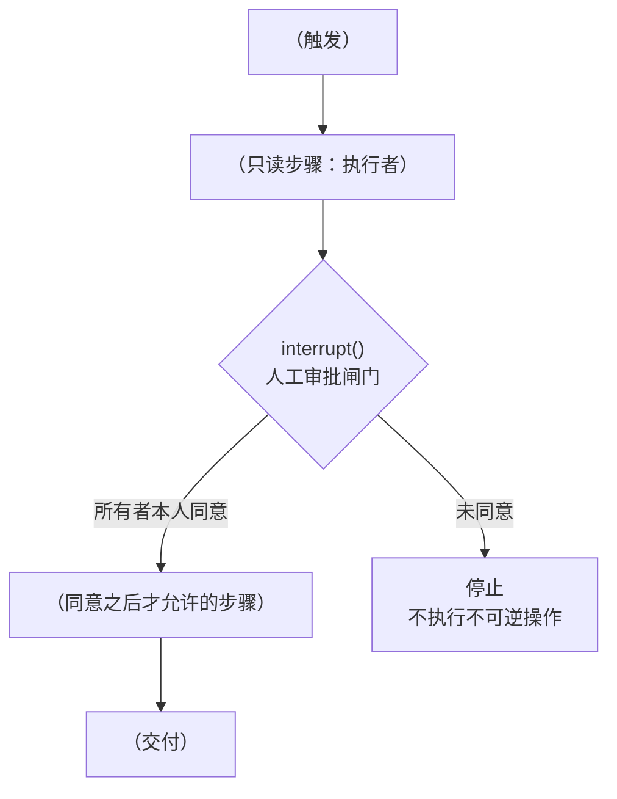

# （填写：构筑名称）

复制本文件为 `docs/sop/NN-<slug>.md` 后填写。带「填写」的位置都是占位，不是已核实事实。删掉用不到的占位行，不要用常识补上未给出的步骤、字段或数字。本节使用说明可以在复制后删除；从「基本信息」起的栏目保留。红线两段原文保留，不可删减。

发布进度用词只描述这篇稿子走到哪一步：`草稿`、`待所有者同意后发布`、`已在 X.com 发布`。这不是 Flow 的字段 schema。

事实等级只使用这三档：`已核实实现`、`附件 / 实践陈述`、`待从飞书 SOP 补齐`。本仓库目前没有可运行产品代码；没有可核验的实现记录时，不要写「已核实实现」。

## 基本信息

| 项 | 内容 |
| --- | --- |
| 构筑编号 | （填写：`NN`，两位序号） |
| 名称 | （填写） |
| 对应 Bot | （填写：Bot 名字；职责全文在 `docs/bots/<bot>.md`） |
| Mind / 定位 | （填写：这个构筑站在哪个角色上想问题，思维边界到哪里为止） |
| 状态 | （填写：草稿 / 待所有者同意后发布 / 已在 X.com 发布） |
| GitHub 路径 | `docs/sop/NN-<slug>.md`（填写实际文件名） |
| X.com | （未发布。得到所有者本人同意并发布后，改为帖子 URL） |
| 自研配置路径 | `flows/`（待建。JSON / YAML 字段 schema 未定，此处不写键名） |
| 状态图路径 | `graphs/`（待建。LangGraph Python 或 TypeScript，尚未放入代码） |

## 一句话钩子与核心结论

钩子：（填写：给读者的一句话。不写未进仓库的数字）

核心结论：（填写：这篇构筑做成之后，人可以据此做什么决定。做不到的部分写明未知）

## The skill / app / system at a glance

一目了然。只用下面四行说清这篇构筑，不在这里展开未定 schema。

| 一眼能看见的东西 | 内容 |
| --- | --- |
| 它是什么 | （填写：skill / app / system 中的哪一种，加上一句说明） |
| 谁启动，谁收结果 | （填写） |
| 人在哪里说「可以」 | （填写：对应原理图里的 `interrupt()` 闸门） |
| 现在还不能自动做什么 | （填写。自动 routine 在上线判据满足前保持关闭） |

## 原理图

下图是占位。把节点名换成这篇构筑的步骤；每一个会对外发送、公开发布、动用资金、承诺价格或交付时间、删除数据、写 ERP 或付款的步骤，都必须经过标成 `interrupt()` 的闸门。店铺登录不画进云端。

图上的闸门对应执行层的 `interrupt()`。闸门画出来，不等于它已经在运行环境里拦住了写操作。

## 工作流与功能

触发方式：（填写：谁、在什么条件下开始。不知道就写「待从飞书 SOP 补齐」，不要编一个触发器）

| 序号 | 步骤 | 执行者 | 停等审批点 | 事实等级 | 这一步算做完的判据 |
| --- | --- | --- | --- | --- | --- |
| 1 | （填写） | （填写：人 / Bot 名 / 外部系统） | （无，或 `interrupt()`：等所有者本人同意） | （填写三档之一） | （填写） |
| 2 | （填写） | （填写） | （填写） | （填写） | （填写） |

步骤序列按实际发生的顺序写。执行者不要写成「系统自动」，要写到具体的人或 Bot。材料里没有的步骤留在表外，用一句话列出待补项：

待从飞书 SOP 补齐：（填写；没有待补项就写「无」）

## 数据来源

字段名等 JSON / YAML schema 拍板后再与配置对齐。下表只记录这篇构筑要查的来源，不发明未出现的字段。

| 字段名 | 含义 | 来自哪个 MCP / API / 第三方 | 读 / 写 | 查不到时的处理 |
| --- | --- | --- | --- | --- |
| （填写；未知就写「字段名未定」） | （填写） | （填写） | （只读 / 写入。写入必须先过闸门） | 标为未知，禁止编造；升级给（填写：谁） |
| （填写） | （填写） | （填写） | （填写） | （填写） |

店铺登录不作为云端数据源。登录只在本地紫鸟。

## 编码编排

Mindwill 自研 JSON / YAML 是配置层，LangGraph 是它下面的状态图执行层。左列是职责，不是字段名。schema 未定之前，不在本表填写键名。

| 配置层要表达的职责 | 映射到的执行层原语 | 本构筑（字段名留空） |
| --- | --- | --- |
| 整篇构筑的状态与转移 | `StateGraph` | （填写：这篇图要记住哪些状态；不写 JSON 键） |
| 可复用子流程 | `Subgraphs` | （填写；没有就写「无」） |
| 暂停之后还要保留的跑次状态 | Checkpointer，如 `PostgresSaver` | 私有云默认 Postgres。连接串不写进本文 |
| 必须停下来等所有者本人同意的点 | `interrupt()` | （填写：与原理图里的闸门如何一一对应） |

语言取向：（填写：Python、TypeScript，或尚未选择）。`@langchain/langgraph` 是 TypeScript 包名；选定语言不是已经写好的图。LangSmith Agent Server 自托管 / standalone 当前不绑定。

## 分析路径与逻辑

按判断顺序写，不把相关性写成原因。每一步都要能指回上一节的数据来源或工作流步骤。

1. （填写：先看什么）
2. （填写：据此排除什么，或认定什么）
3. （填写：仍然未知、因此不能下的结论）

材料不够时，把这一节留在「待从飞书 SOP 补齐」，不要补一套分析口径。

## 实现目的与输出结果

| 项 | 内容 |
| --- | --- |
| 目的 | （填写：这篇构筑要替人完成的判断或准备） |
| 输出格式 / UI / 看板 | （填写；尚未设计就写「未设计」） |
| 交付给谁 | （填写） |
| 什么时候交付 | （填写） |
| 是否固定任务，频次是什么 | （填写。固定任务在上线判据满足前不开启） |
| 结论如何影响决策 | （填写：人看到结果后可以改什么决定；不能改的写明） |

## 四栏能力卡

只写已有材料能支撑的条目。没有就写「尚无」，不要用行业常识填。

| 栏 | 所指 | 本构筑 |
| --- | --- | --- |
| Memories | Facts it already knows | （填写） |
| Skills | Playbooks it can run | （填写） |
| Routines | Jobs that run on their own | 默认关闭。人工跑通一轮，并且确认闸门能拦住写操作之前，不填写具体频次，也不开启 |
| Integrations | Apps it can use | （填写已获同意的连接。店铺登录不列为云端集成） |

## 关联 Bot 职责摘要

主责 Bot：（填写名字）

职责全文见 `docs/bots/<bot>.md`。这里只摘要，不另写一套边界：

- 负责：（填写）
- 可以查：（填写）
- 可以交给它的工具：（填写）
- 最后要交的结果：（填写）
- 查不到时：（禁止编造；升级给填写的人）

## 统一不可逆操作红线

下面两段原文保留，不可删减，不可改写成更宽的例外。

凡是对外发送消息或文件、公开发布内容、动用资金、承诺价格或交付时间、删除数据，以及其他任何不可逆操作，都必须先停下来征得所有者本人同意。

跨境运营补充闸门：店铺登录只在本地紫鸟、绝不上云；ERP 等外部系统的写操作与付款一律人工确认。

## 上线判据

You're ready to move on when：

1. 人工跑通一轮。这一轮的输入是（填写），预期输出是（填写）。还没设计就保持空白，不要编一轮样例。
2. 确认闸门能拦住写操作。未得到所有者本人同意时，对外发送、公开发布、动用资金、承诺价格或交付时间、删除数据、ERP 写操作和付款都没有发生。店铺登录没有离开本地紫鸟。
3. 只有 1 和 2 都成立，才把四栏里的 routine 从关闭改为开启，并写上频次。

当前填写：尚未跑通。自动 routine 关闭。

## X.com 发文同步检查清单

长文与本文件同一骨架之后再发。未勾选「所有者本人已同意」时，不发布。

- [ ] 钩子、核心结论与本文件一致，没有多写未进仓库的数字
- [ ] 配图含原理图，并标出 `interrupt()` 人工审批闸门
- [ ] 四栏卡（Memories / Skills / Routines / Integrations）与本文件一致
- [ ] Bot 职责卡与 `docs/bots/<bot>.md` 一致
- [ ] 红线两段原文仍在，没有删减
- [ ] 文末给出本篇 GitHub 链接
- [ ] 所有者本人已同意公开发布
